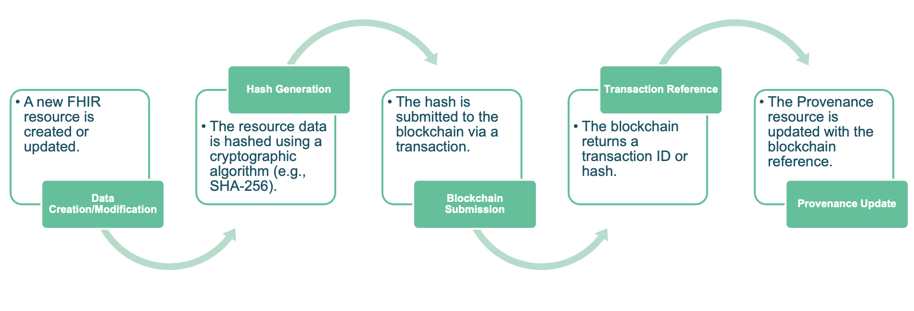

# Content Trust Framework - Gravitate Health FHIR Implementation Guide v0.1.0

* [**Table of Contents**](toc.md)
* **Content Trust Framework**

## Content Trust Framework

The Provenance resource records information about the origin, custody, and transformations of a resource. It captures metadata about the creation, modification, and versioning of data.

The key elements are:

1. Target: The resource(s) that this provenance information is about.
1. Recorded: The time at which the activity occurred.
1. Agent: Who was involved in the activity.
1. Activity: What was done to the resource

The transactionID is stored in the extension and not signature. Which lets that space to be used for further information or proper signature usage.

The workflow can go as:

  

